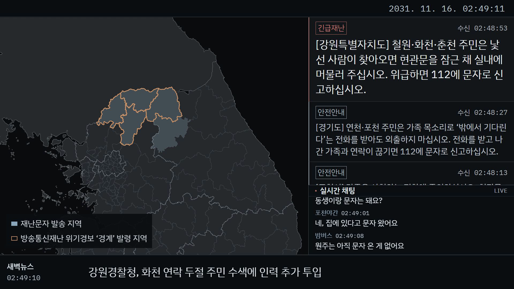

# 재난방송실

재난방송실은 가상 재난방송 영상을 만드는 명령줄 도구입니다. 시나리오 파일에서 재난문자, 뉴스, 지도와 음향을 배치하고, 브라우저에서 미리 본 뒤 1080p 60fps MP4로 출력할 수 있습니다.



## 첫 영상 만들기

Node.js 22 이상을 준비한 뒤 새 작품 폴더에서 실행하세요.

```sh
mkdir my-film
cd my-film
npm install disaster-broadcast-studio
npx dbs init
```

생성된 `scenario.yaml`에서 제목, 허구 고지, 장면별 내용을 편집합니다. 아래 명령이 출력하는 주소를 브라우저에서 열고 재생하세요. 파일을 저장하면 미리보기에 반영됩니다.

```sh
npx dbs preview scenario.yaml
```

장면이 확정되면 미리보기를 Ctrl+C로 종료한 뒤 영상을 출력하세요.

```sh
npx dbs render scenario.yaml --out output/film.mp4
```

영상과 함께 만들어지는 `output/film.mp4.credits.txt`에서 게시에 필요한 출처를 확인할 수 있습니다.

## 제작 참고

- 장면을 작성하거나 명령 옵션을 확인할 때는 [작품 파일 형식과 CLI](skills/scenario-writing/references/format.md)를 보세요.
- AI와 함께 대본과 연출을 작성하려면 [시나리오 작성 스킬](skills/README.md)을 설치하세요.

코드는 [MIT](LICENSE)이며, 지도·글꼴·음향에는 [자산별 이용조건](assets/README.md)이 적용됩니다. [Remotion 이용조건](https://www.remotion.dev/pricing)도 확인하세요.
