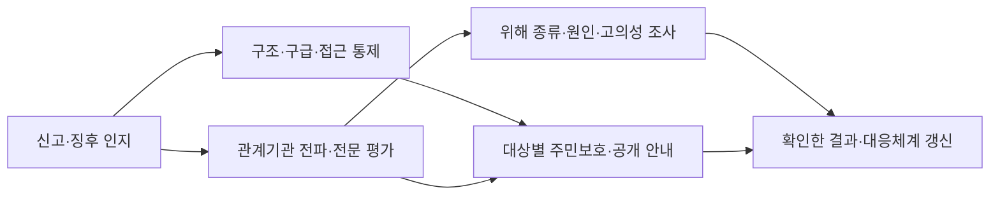

# 화생방 공격·테러 의심 상황의 공적 대응

확인일: 2026-11-15. 공개 법령과 정부 행동요령을 창작용으로 요약했다. 화학·생물·방사능·핵이라는 위해의 종류와 고의 공격·사고라는 원인을 구별하며, 관객이 공개 정보로 알 수 있는 대응을 설계하는 자료다. 아래 **사실 요약**과 **창작 적용**을 구별한다.

## 먼저 사건의 성격과 정보의 확실성을 나눈다

| 극중 확인한 사실 | 바로 같은 뜻으로 쓰지 않을 것 | 함께 볼 자료 |
| --- | --- | --- |
| 공장 누출·이상 기체 신고 | 적의 화학공격 또는 화학테러 확정 | [화학사고 대응](health-and-hazard-response.md#2-유해화학물질-누출과-화학사고) |
| 원인불명 집단 증상·사망 | 생물작용제 살포·사람 간 전파 확정 | [감염병·원인불명 질병](health-and-hazard-response.md#1-집단-이상-증상과-감염병) |
| 원전 방사선비상·방사능 검출 | 핵 공격·핵폭발·전국 오염 | [원자력시설 방사선비상](health-and-hazard-response.md#3-원자력시설의-방사선비상) |
| 의심 물체·우편물·백색 분말 | 유해물질 검출·테러 목적 입증 | 아래 초동 조치·조사 구분 |
| 적의 공격 징후·공격 확인 | 모든 재난경보·테러경보의 자동 격상 | [민방위 경보](civil-defense.md), [전시·비상 체계](war-and-emergency-system.md) |

**사실 요약.** [테러방지법](https://www.law.go.kr/LSW/lsInfoP.do?efYd=20240209&lsiSeq=253319) 제2조는 국가 등의 권한행사를 방해하거나 공중을 협박하는 목적과 열거한 행위를 함께 정의한다. 이상 증상·폭발·오염이라는 결과만으로 법률상 테러인지를 확정하지 않는다. 적의 군사공격, 테러 의심, 산업사고는 처음부터 같은 지휘체계라는 뜻도 아니다.

**창작 적용.** 초기에 기관이 확인한 물리적 위험과 나중에 확인한 원인·고의성·공격 주체를 따로 갱신한다. 신고를 받고 접근을 통제했다고 해서 그 기관이 테러나 적의 공격을 확정 발표한 것은 아니다.

## 1. 공개 법령의 기준과 역할

### 확인한 판본

| 자료 | 확인 범위 |
| --- | --- |
| [「국민보호와 공공안전을 위한 테러방지법」](https://www.law.go.kr/LSW/lsInfoP.do?efYd=20240209&lsiSeq=253319) | 2024-02-09 시행, 법률 제19580호(2023-08-08 타법개정). 제2~8조의 정의·책무·조정·전담조직 |
| [같은 법 시행령](https://www.law.go.kr/LSW/lsInfoP.do?efYd=20261002&lsiSeq=290359) | 2026-10-02 시행, 대통령령 제36728호(2026-09-29 타법개정). 제12~24조의 협의체·본부·경보·초동 조치 |
| [「민방위 경보 발령·전달 규정」 공식 게시물](https://www.mois.go.kr/frt/bbs/type001/commonSelectBoardArticle.do?bbsId=BBSMSTR_000000000016&nttId=122926) | 2026-01-05 시행, 행안부 예규 제355호. 본문·별표는 [민방위 경보 자료](civil-defense.md)에 수록 |
| [행안부 「비상시 국민행동요령」 2025년 판](https://www.mois.go.kr/ebook/EmergencyGuidelines/2025/catImage/15/Emergency_Action_Guidelines_2025.pdf) | 인쇄 13~19쪽의 화생방·핵 경보와 주민 행동. PDF 텍스트 추출이 깨져 해당 페이지를 시각 확인 |

2025년 행동요령의 개요와 2026년 경보 규정의 법정 문언이 다르면 해당 시기의 규정으로 발령·전달을 확인한다. 과거 「국가대테러활동지침」에 대한 설명이나 예전 기관명을 현재 법령 대신 사용하지 않는다. 법 제6조의 장단기 대테러활동 지침 작성·배포 근거와, 공개 전문을 확인하지 못한 내부 지침의 실제 내용도 구별한다.

### 국가 조정과 현장 대응의 차이

**사실 요약.** 법 제3·5~8조와 시행령 제12~17조를 요약한 역할표다.

| 기구 | 역할·관계 |
| --- | --- |
| 국가테러대책위원회 | 국무총리 주재. 국가 정책·중장기 대책·관계기관 역할 분담 등 중요사항 심의·의결 |
| 대테러센터 | 국무총리 소속. 기관 간 실무 조정·협조, 테러경보 발령 등 |
| 지역 테러대책협의회 | 지역기관 간 예방·대응 지원 협의. 의장은 국정원 관할지부장, 특별시는 대테러센터장 |
| 테러사건대책본부 | 사건 유형별 주관기관이 설치. 현장지휘본부의 대응 활동 지휘·통제 |
| 현장지휘본부 | 사건 현장 대응 총괄과 전문조직 구성·지원 요청. 본부장은 사건대책본부장이 지명 |
| 화생방테러대응지원본부 | 화학: 기후에너지환경부, 생물: 질병관리청, 방사능: 원안위. 분야별 전문 지원 |
| 테러복구지원본부 | 행안부장관이 설치·운영 가능. 구조·구급·수습·복구 지원 |

사건대책본부의 주관은 국내 일반(경찰청), 군사시설(국방부), 항공(국토부), 해양(해경청), 국외(외교부)로 나뉜다. 군사시설 사건대책본부장은 합참의장이라는 예외가 있다. 분야별 지원본부나 지역 협의회를 모든 사건의 최상위 현장 명령기관으로 바꾸지 않는다.

법 제3·7조는 적법절차·기본권 존중과 대테러 인권보호관을 규정한다. 대테러 대응이라는 말만으로 무제한 구금·검열·군정이 성립하지 않는다. 계엄·통합방위·동원은 [별도 법률과 결정](war-and-emergency-system.md)을 확인한다.

## 2. 원인이 확정되기 전의 구조와 위험 저감

**사실 요약.** [소방기본법 제16조](https://law.go.kr/LSW/lsLinkCommonInfo.do?chrClsCd=010202&lsJoLnkSeq=1034442795)(2026-09-03 시행, 법률 제21731호)는 위급한 상황의 출동·진압·구조·구급을 규정한다. [경찰관 직무집행법 제5조](https://www.law.go.kr/lsLinkCommonInfo.do?chrClsCd=010202&lsJoLnkSeq=1030491623)(2026-07-07 시행, 법률 제21304호)는 위험한 사태의 경고·필요한 한도의 이동 제한·대피 등을 다룬다. 이런 초동 조치가 테러 목적의 최종 입증을 기다리는 것은 아니다.

테러 대응 절차에서는 시행령 제23조가 상황 전파, 현장 통제·보존, 긴급대피·구조·구급, 지원 요청을 정한다. 국내 일반테러는 사건대책본부 설치 전까지 관할 경찰관서장이 해당 초동 조치를 지휘·통제한다. 제24조는 지자체의 지원 물자·편의 제공과 주민 긴급대피 방안 마련을 규정한다.

**창작 적용.** 아래는 공적 대응을 집필하기 위한 병행 관계도이며 법정 필수 순서나 소요시간표가 아니다.

실제 작품에서는 다음을 구별하면 기관의 지식이 단계적으로 늘어나는 장면을 만들 수 있다.

- 최초 신고의 냄새·분말·증상, 전문 탐지의 잠정 결과, 정밀 분석 결과, 수사상 고의성 판단은 다른 정보다.
- 누군가 쓰러졌다는 신고 단계에서도 구급·위험구역 접근 제한은 가능하다. 지휘본부가 생길 때까지 모든 현장기관이 정지해 있지 않는다.
- 물질 확인은 관계 전문기관, 환자 평가·진료는 보건·의료기관, 사건 고의성·행위자 조사는 정보·수사기관의 확인 범위에 맞춘다. 기관 하나가 모든 결론을 동시에 내리지 않는다.
- 지자체는 주민보호와 지역 지원을 맡고 군·경·소방·전문기관은 공개 법령에 따른 역할로 협업한다. 군 전문지원이 왔다는 사실을 계엄이나 군의 전체 행정권 인수로 표현하지 않는다.

## 3. 위해 종류에 따라 연계할 기관과 정보

**사실 요약.** 시행령 제16조는 분야별 지원본부의 오염 확산 방지·독성제거 방안, 전문 인력·자원 지원을 규정하고 국방부의 대화생방테러 전문지원 조직 근거를 둔다. 제19조에 따라 소방청장과 시도지사가 설치하는 테러대응구조대는 초기 구조·구급, 오염 확산 방지·독성제거 등을 맡는다. 제20~21조는 테러정보 분석·평가와 관계기관 합동 조사 등을 별도로 다룬다.

아래 표의 ‘확인할 정보’는 이 역할 구분을 바탕으로 한 **집필용 구성안**이다. 장비 성능·출동 편제·확정 지휘계획을 나타내지 않는다.

| 위해 | 작품에서 연결할 공개 주체 | 공개 발표를 읽을 때 확인할 정보 |
| --- | --- | --- |
| 화학 | 소방·경찰·환경당국·화학물질안전원·지자체, 필요한 군 전문지원 | 의심 물질과 확인 물질, 탐지·분석·확산평가의 구분, 주민보호 대상과 이동 경로 |
| 생물 | 의료기관·보건소·시도·질병청, 정보·수사기관 | 증상·사례정의·검사·역학적 연관과 고의 살포의 입증을 구별 |
| 방사능 | 원안위와 방사선 전문기관·소방·경찰·지자체 | 방사선량·오염 여부·영향평가, 접근 제한·주민보호의 범위와 근거 |
| 핵 공격 | 군의 경보 요청, 민방위 경보체계와 정부·지자체의 주민 안내 | 공격 임박·진행 경보, 실제 관측·피해·낙진 정보, 각 발표의 시각·대상 지역 |

화학물질 누출·생물학적 유행·원전 사고로 판단이 바뀌면 [평시 재난·보건의 절차](health-and-hazard-response.md)도 확인한다. 테러 가능성 조사와 인명피해 대응이 병행될 수 있으며 ‘테러가 아니다’라는 판단이 곧 오염·피해 부재를 의미하지 않는다.

## 4. 경보와 주민 행동 안내를 맞춘다

### 테러경보와 민방공 경보

**사실 요약.** 시행령 제22조의 테러경보는 대테러센터장이 위험 징후를 평가하여 범위·기간·단계를 정하는 관심·주의·경계·심각의 체계다. 민방공 경보의 화생방경보·핵 경보, 재난문자 등급, 원전의 백색·청색·적색비상과 동일하지 않다.

[2026년 민방위 경보 규정](civil-defense.md)의 제4·7~10조는 다음을 구별한다.

| 구분 | 언제·어떤 경로인가 |
| --- | --- |
| 화생방경보 | 적의 화생방작용제 살포·탐지, 화생방 공격에 따른 오염 예상 또는 공격 확인 |
| 핵 경보 | 적의 핵 공격 임박 또는 진행 |
| 군의 요청과 경보 전달 | 정해진 군 지휘권자의 발령 요청, 경보통제소·지자체의 발령·전달 절차 |
| 방송·사이렌·문자 | 종류별 수단과 신호가 다름. 화생방경보를 핵 경보와 같은 사이렌으로 자동 처리하지 않음 |

의심 우편물 신고를 받았다는 이유만으로 적의 화생방공격 경보가 전국에 발령되는 구성을 만들지 않는다. 극중 실제 발령·전달된 종류·지역·발령사유를 먼저 정하고 [별표의 해당 매체 문안](civil-defense.md)을 사용한다.

### 주민 행동 안내에서 중요한 차이

**사실 요약.** 행안부 2025년 행동요령의 다음 절을 확인했다. 인쇄 쪽수이며 법정 발령기준이나 모든 현장에 적용하는 단일 처방은 아니다.

| 위험 | 확인한 안내와 장면에 필요한 구별 |
| --- | --- |
| 화학공격 확인(13~14쪽) | 공습으로 지하에 대피한 뒤 화학공격이 확인되면 비오염지역 또는 외부 공기 차단이 가능한 건물 높은 층의 실내 등으로 이동하는 안내. 지형·풍향·현장 안내를 함께 고려 |
| 생물학적 공격(16~17쪽) | 병원체 규명에 시간이 걸릴 수 있음. 오염지역 이탈 후 지정 장소·실내 체류, 타지역 이동 자제, 정부 안내에 따른 검사·치료 등 |
| 의심 우편물(17쪽) | 개봉하지 않고 접근을 피하며 보건소·1339 등에 신고하도록 안내. 분말의 외형만으로 병원체 확정 불가 |
| 핵 경보·핵폭발(18~19쪽) | 임박 경보에 따른 대피와 실제 폭발 순간의 신체 보호·이후 낙진 회피를 구별. 가능한 지하·차폐 공간과 후속 정부 안내에 따른 행동 |

**창작 적용.** 공습 때 지하로 향하던 주민이 후속 화학공격 안내에 따라 이동하는 장면은 위험 종류가 달라진 결과일 수 있다. 이를 자동으로 오발령·거짓말로 처리하지 않는다. 반대로 미상 물질이나 방사능 상황에 화학공격의 높은 층 안내를 일률적으로 옮기지도 않는다.

## 5. 공개 현황판·뉴스에 옮기는 판단

다음은 공식 규정의 인용이 아닌 집필 지침이다.

- 현황판이 아는 것은 공개된 경보·문자·기관 발표·보도다. 군의 탐지 원자료나 비공개 대테러 회의·수사자료를 실시간으로 읽는 화면으로 만들지 않는다.
- `의심 신고` → `안전 확인·분석 중` → `검출 여부와 주민 조치`처럼 확인 수준을 갱신하되 결과를 미리 정한 매 분 발표 순서로 강제하지 않는다.
- 문자에는 발신기관이 지금 대상자에게 요구하는 행동을, 뉴스에는 누가 무엇을 확인·조치했다고 발표했는지를 적는다. 구호소 개방·시설 폐쇄·검사 대상·이동 통제의 범위도 서로 구별한다.
- 공격 주체·작용제·확진·오염·피폭·사망 집계는 각각 근거와 기준시각을 갖는다. 기관의 잠정 평가를 확정 사실로 바꾸거나 미검출을 모든 위해 부재로 확대하지 않는다.
- 경보 해제, 안전성 평가, 통제 해제, 주민 귀환, 의료 추적과 복구 완료를 같은 시점으로 자동 처리하지 않는다.

특정 위협·반전·피해 규모를 모든 작품에 강제하지 않는다. 필요한 법령·공개 자료만 더 확인하며, 비공개 전술·탐지 능력·구체 부대 배치나 확인하지 않은 대피 반경을 실제 제도로 채워 넣지 않는다. 전시·계엄·동원·통합방위의 조건은 [전시·비상 체계](war-and-emergency-system.md), 실제 방송 형식은 [민방위 경보](civil-defense.md), 사건의 공적 발표와 매체별 문체는 [뉴스 표현](news-writing.md)을 따른다.
